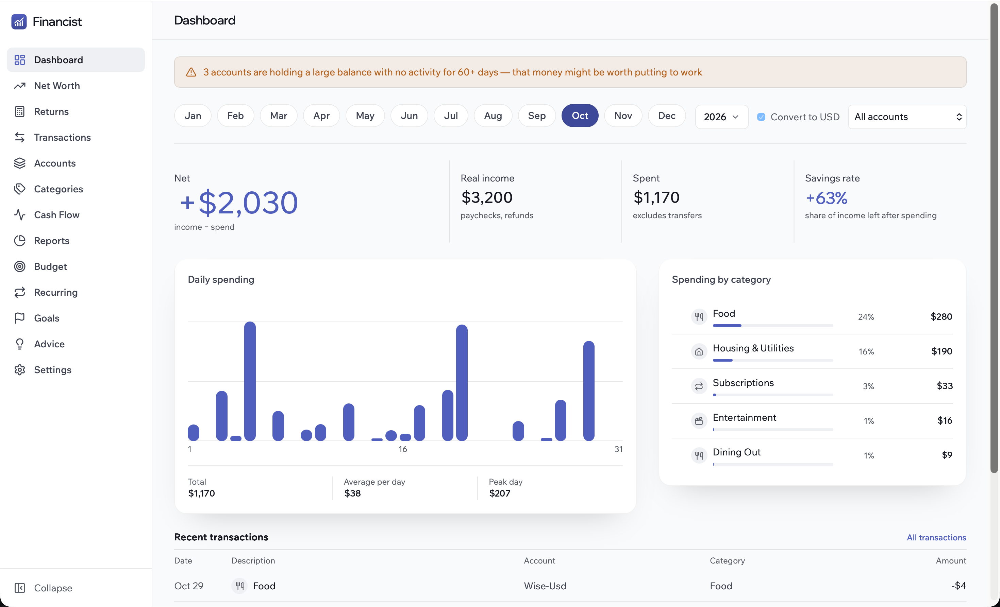
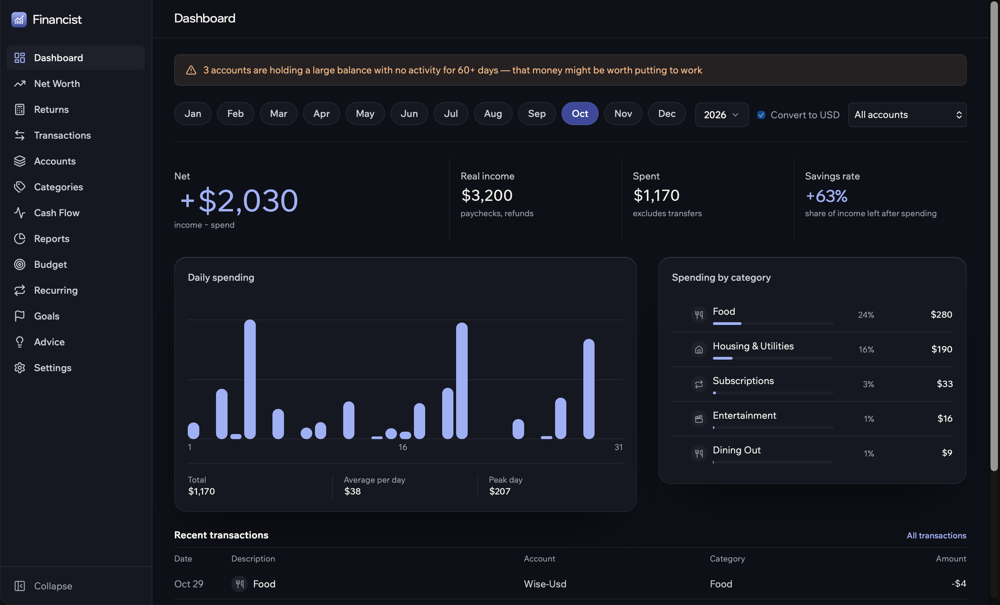

# Financist

A personal finance desktop app. Track spending, accounts, net worth and goals — **all your data stays on your machine** in a local SQLite file. No cloud, no accounts, no telemetry.

| Light | Dark |
| --- | --- |
|  |  |

## Features

- **Dashboard** – monthly income, spending, net and savings rate, spending by category, recent transactions
- **Transactions & accounts** – income / expense / transfer, tags, multiple accounts (checking, savings, cash, investment…)
- **Multi-currency** – per-account currencies with FX rates and an optional "convert to USD" view
- **Budgets, goals & recurring payments**
- **Net worth, cash flow, reports & ROI calculator**
- **Alerts & advice** – e.g. idle balances that could be put to work
- **CSV import** and **backup** from Settings

## Your data

Everything is stored locally in a single SQLite file:

```
~/Library/Application Support/Financist/financist.db
```

On Windows: `%AppData%\Financist\financist.db`.

Back it up or move it by copying that file, or use Export / Import Backup in Settings.

## Install (macOS)

Requirements: [Go](https://go.dev/dl/), [Node.js](https://nodejs.org/) and [Wails v2](https://wails.io/docs/gettingstarted/installation) (`go install github.com/wailsapp/wails/v2/cmd/wails@latest`).

```bash
git clone https://github.com/dimakohanskyi/financist.git
cd financist
make install   # builds the app and copies it to /Applications/Financist.app
```

Other commands: `make dev` (live-reload dev mode), `make app` (build only → `build/bin/Financist.app`).

## Install (Windows)

Not tested on Windows yet. Requirements: [Go](https://go.dev/dl/), [Node.js](https://nodejs.org/) and [Wails v2](https://wails.io/docs/gettingstarted/installation) (`go install github.com/wailsapp/wails/v2/cmd/wails@latest`). Windows 10 also needs the [WebView2 runtime](https://developer.microsoft.com/microsoft-edge/webview2/) (already included in Windows 11).

```powershell
git clone https://github.com/dimakohanskyi/financist.git
cd financist
wails build -clean
```

Run `build\bin\Financist.exe`. To get an installer instead, install [NSIS](https://nsis.sourceforge.io/) and run `wails build -clean -nsis`.

## Tech

Go + GORM + SQLite, GraphQL (gqlgen), React + TypeScript, packaged with Wails.
